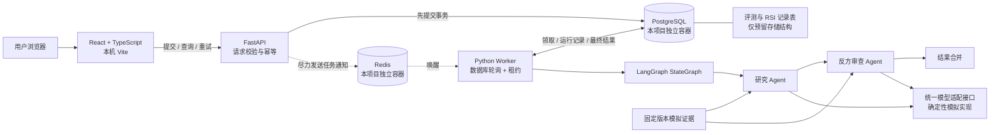
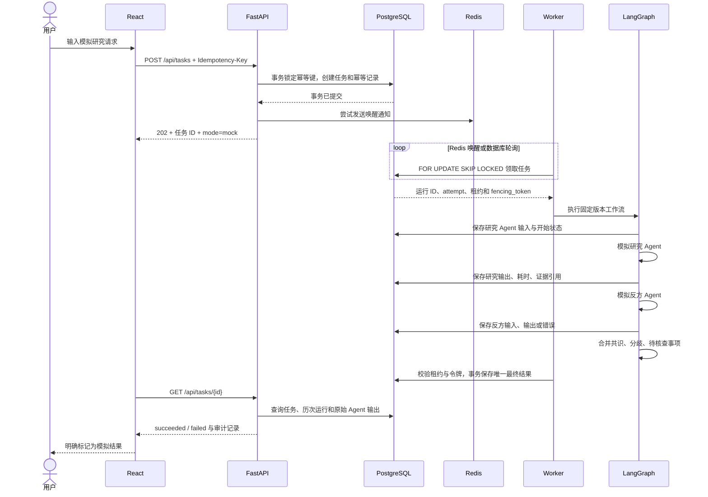

# 第一阶段架构与职责

这是单用户、本机开发的模块化单体骨架。研究数据和 Agent 判断全部来自确定性模拟。真实数据、真实模型、交易执行与自动 RSI 均未接入。

## 运行边界



API 与 Worker 共用 Python 包、领域结构、迁移和数据库，并非独立微服务。Redis 是有界的任务唤醒列表；持久队列是 PostgreSQL 中的任务状态。任何 Redis 数据丢失均不应删除已提交的任务。

开发期 React、API、Worker 直接在宿主机运行。按用户最终选择，PostgreSQL 与 Redis 都由 Docker Compose 管理，统一项目组为 `investment-thesis-arena`，容器分别为 `investment-thesis-arena-postgres` 和 `investment-thesis-arena-redis`。PostgreSQL 使用 `127.0.0.1:55433`，Redis 使用 `127.0.0.1:56379`。本机已有的 `study-plan-postgresql` 服务、`E:\pgsql\data`、5432 端口不做修改。应用容器镜像留待部署阶段。

## 最小任务时序



## 逻辑模块

```text
Investment Thesis Arena/
├── frontend/                 # React、TypeScript、Vite 与前端测试
├── backend/
│   ├── app/
│   │   ├── api/ data/ discovery/ analysis/
│   │   ├── agents/ orchestration/ decisions/ portfolio/
│   │   └── evaluation/ rsi_lab/ infrastructure/
│   ├── alembic/              # 显式、可追踪迁移
│   ├── tests/                # 单元与真实 PostgreSQL 集成测试
│   ├── pyproject.toml
│   └── uv.lock
├── scripts/                  # 启停、黑盒故障验收与浏览器演示
├── docs/                     # 架构、契约、审查、验收与后续边界
├── artifacts/                # 测试报告、截图、演示任务 JSON
├── compose.yaml              # 同组 PostgreSQL / Redis 容器
├── .env.example
└── .runtime/                 # 本机日志、PID、QA 环境；不纳入 Git
```

| 路径 | 本轮职责 | 后续边界 |
|---|---|---|
| `backend/app/api` | HTTP 请求与任务接口 | 鉴权、限流、查询分页待设计 |
| `backend/app/data` | 固定版本模拟证据包 | 行情、事件供应商与时点数据 |
| `backend/app/discovery` | 市场与代码格式校验 | 候选发现算法未实现 |
| `backend/app/analysis` | 请求、Agent 结果结构 | 独立指标计算模块边界，未设指标阈值 |
| `backend/app/agents` | 模型接口与两种模拟角色 | 真实供应商适配与成本采集 |
| `backend/app/orchestration` | LangGraph、状态转换、租约、幂等、持久化 | 长任务调度与节点续跑策略 |
| `backend/app/decisions` | 合并结构化研究结论 | 人工决策记录与投资假设版本 |
| `backend/app/portfolio` | 显式保留命名空间 | 未创建真实持仓、账户或交易接口 |
| `backend/app/evaluation` | 测试集、基线、候选版本与评测记录表 | 数据集和评测器未实现 |
| `backend/app/rsi_lab` | 提案、实验、评测关联、人工批准、回滚记录表 | 无运行配置写入、代码修改或自动晋级路径 |
| `backend/app/infrastructure` | 环境配置、数据库、Redis、错误结构 | 分布式追踪与运营指标待设计 |
| `frontend/src` | 请求表单、状态轮询、结果、运行轨迹 | 不展示虚构行情或投资收益 |

## 数据与一致性

- `tasks`：研究请求、状态、运行版本、尝试次数、租约、当前运行 ID 和 fencing token。
- `idempotency_requests`：幂等键主键、动作与规范化请求摘要、任务 ID。创建和重试共享键空间，避免键被重新用于另一动作。
- `task_runs`：一次执行一条记录，唯一约束 `(task_id, attempt)`；重试保留旧运行及错误。
- `agent_runs`：角色、输入、输出、证据引用、执行状态、耗时、错误、供应商与模型标识、可空 token 与成本；唯一约束 `(run_id, role)`。
- `task_results`：`task_id` 为主键，成功后仅保留一份最终结果，同时保留各 Agent 原始输出。
- `evaluation_runs`：评测 ID、测试集版本、基线版本、候选版本、状态和指标 JSON。
- `rsi_proposals`、`rsi_experiments`、`rsi_evaluations`、`rsi_approvals`、`rsi_rollbacks`：提案到回滚的离线记录结构。仅有数据结构，不提供自动实验或批准服务。

相同幂等键和请求返回同一任务；同键不同请求返回 409。不同幂等键代表用户有意发起的新任务，即使研究内容相同也不自动去重。失败重试仍使用原任务 ID，增加尝试记录；成功任务不可重试。

并发 Worker 通过行锁领取任务。租约使用数据库时间，心跳续租。Worker 崩溃后，其他 Worker 可回收过期租约，旧运行记失败；持有过期令牌的 Worker 无权写入结果。任务可重复执行，但业务任务和成功结果由事务及唯一约束保证不重复；不宣称模型调用只执行一次。

Redis 故障时 API 仍先落库，Worker 退回数据库轮询。PostgreSQL 不可用时 API 返回不带连接串的 503，Worker 等待恢复。`/healthz` 证明 API 进程可响应；`/readyz` 检查迁移后的任务表和 Redis，不证明 Worker 正在运行。

## LangGraph 最小方案评估

本轮图为 `START → researcher → challenger → synthesis → END`。反方节点读取研究输出，两者以相同证据版本为依据。使用真实 `StateGraph.compile()` 和异步执行，节点本身为确定性 Python 实现。该用法符合 [LangGraph Graph API 官方说明](https://docs.langchain.com/oss/python/langgraph/graph-api)。

本轮不启用 LangGraph checkpointer：任务和 Agent 审计记录由应用数据库管理。崩溃后按新的 attempt 从图起点重跑，历史 trace 保留。后续如需节点级续跑，应单独设计 checkpointer 与业务事务的边界；当前实现不能据此宣称已经支持节点级断点续跑，也未证明 Multi-Agent 的研究质量优于单 Agent。

## 配置与后续安全边界

配置由 `ARENA_*` 环境变量或本地 `.env` 提供。当前模式只接受 `mock`，无需 API Key。未来供应商必须实现模型适配接口并有自己的超时、可用性、成本和隐私策略。错误记录使用固定错误码及消息，避免把供应商异常中的凭据保存或返回。

当前为本机单用户开发工具，未实现认证、授权与公网部署防护。启动脚本绑定 loopback。独立评测与人工批准是下一阶段 RSI 候选晋级的必要设计边界；本轮预留表不会触发运行配置或代码变更。
