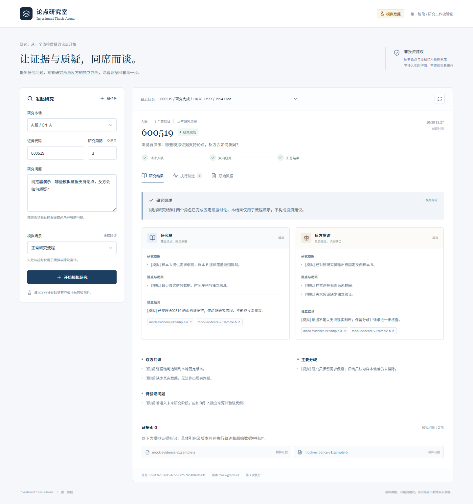

# 第一阶段验收与实际演示

执行日期：2026-10-28，Asia/Shanghai。所有业务数据与 Agent 输出均为模拟；PostgreSQL、Redis、API、Worker、LangGraph 和浏览器为实际启动的组件。

## 自动化结果

| 检查 | 结果 | 证据 |
|---|---|---|
| 后端 pytest | **36 通过、0 跳过、0 失败**，19.57 秒 | `artifacts/backend-tests.xml` |
| 前端 Vitest | **12 通过、0 失败** | `artifacts/frontend-tests.xml` |
| TypeScript + Vite 构建 | 通过；JS gzip 78.17 KB，CSS gzip 5.06 KB | `frontend/dist`（本机生成、不纳入 Git） |
| Ruff | 通过 | `ruff check app tests alembic` |
| Alembic | 当前版本 `0001_phase_one`；`alembic check` 无结构漂移 | 显式迁移及数据库版本表 |
| 运行中系统黑盒验收 | **24 项通过** | `artifacts/runtime-verification.json` |
| 真实浏览器验收 | **11 项通过**，页面异常和 console error 均为 0 | `artifacts/browser-verification.json` |
| 前端依赖审计 | 0 条已知漏洞报告 | 已将测试工具更新至 Vitest 5.0.5 |
| 启停脚本 | 重复启动不增加进程，停止/重启后数据保留 | `artifacts/runtime-lifecycle.json` |
| 数据库直接核对 | 7 个任务、9 次运行、18 条 Agent 记录、5 份成功结果；重复结果/尝试均为 0 | `artifacts/database-snapshot.json` |

后端集成测试使用真实 PostgreSQL 的独立随机 schema；没有用 SQLite 替代数据库验收。测试覆盖 API 校验与状态、真实 LangGraph 执行、错误持久化、并发提交、并发重试、幂等键跨动作冲突、租约过期回收、旧 Worker 写入隔离、心跳失败、异步取消恢复、Redis 不可用、数据库错误脱敏与 RSI 预留表。

最终数据库查询确认 `pg_extension` 仅有 `plpgsql`，未启用 vector；不存在剩余 `arena_test_*` schema。运行依赖版本见 `artifacts/backend-versions.json`，应用依赖由 `uv.lock` 和 `package-lock.json` 固定。

## 浏览器演示

使用已安装 Microsoft Edge 156.0.4314.42、Playwright 1.64.1，以无头模式操作实际前端。桌面视口 1440×1040，移动视口 390×844。

1. 前端输入 `CN_A / 600519 / 3 个交易日`，问题为“浏览器演示：哪些模拟证据支持论点，反方会如何质疑？”并点击“开始模拟研究”。
2. FastAPI 返回真实任务 ID，后台 Worker 领取任务，LangGraph 执行研究与反方两个角色，最终结果写入 PostgreSQL。
3. 页面显示成功结果、依据、疑点、结论和模拟证据引用；展开执行轨迹，可读取各 Agent 的原始输入输出。
4. 刷新后恢复任务，再次提交同一请求仍返回同一任务。
5. `fail_once` 场景先失败，点击重试后同一任务成功，保留两次运行；`timeout` 场景记录 `MODEL_TIMEOUT` 和已完成的研究 Agent 输出。
6. 移动视口没有横向溢出。

| 浏览器任务 | 实际 ID | 最终状态 | 次数 |
|---|---|---|---|
| 正常研究 | `195412ed-56d0-42bc-922c-70d4846db73c` | succeeded | 1 |
| 失败后重试 | `bc785adf-478f-455a-879d-94ee51b1375c` | succeeded | 2 |
| 模拟超时 | `2ff3fd19-8622-4ae8-92c4-6a4d69f859ea` | failed，符合预期 | 1 |

可在前端最近任务列表中按 ID 前缀识别，或请求 `GET /api/tasks/{id}`。完整 JSON 保存于 `artifacts/browser-verification.json`。



其他截图：`demo-initial.png`（初始界面）、`demo-trace.png`（原始轨迹）、`demo-failure.png`（首次失败）、`demo-retry.png`（两次执行记录）、`demo-timeout.png`（超时）、`demo-mobile.png`（手机宽度）。

## 实际故障与持久化验证

以下检查使用真实运行中的组件，而非仅模拟数据库/Redis 客户端：

- 8 个并发 HTTP 请求携带同一幂等键，均返回同一任务 ID，只有 1 次运行。同键不同 payload 返回 409。
- 成功任务重试返回 409；失败任务重试沿用任务 ID；重放已完成的重试请求不增加次数。
- 停止本项目 Redis 容器后，`/readyz` 返回 200 且标记 degraded。新任务 `6e0b44a7-54a0-41a9-bc59-c647a8546fa2` 经数据库轮询成功完成。随后恢复 Redis。
- 停止本项目 PostgreSQL 容器后，`/readyz` 和任务查询返回 503。错误响应不含连接密码。
- 恢复 PostgreSQL 后，任务 `6b7905f6-39cd-48db-b65f-b8f8a9d733bb` 的完整结果与轨迹和重启前完全一致；原幂等键继续返回同一任务且尝试次数为 1。

重现命令（在项目根目录，应用运行且没有其他待处理任务时）：

```powershell
python scripts/verify_runtime.py --redis-outage --postgres-restart
.\.runtime\qa-venv\Scripts\python.exe scripts/browser_demo.py --browser-channel msedge
```

脚本故障检查的 `finally` 会恢复被停止的本项目依赖。它们创建模拟任务作为验收记录，不清空业务数据库。

## 验证中修复的问题

- 前端测试依赖曾有已知漏洞报告，升级至 Vitest 5.0.5 后审计为 0，并重新通过测试与构建。
- 初次浏览器检查发现缺少 favicon 导致 404，已加入本地 SVG 图标，最终浏览器检查无 console error；默认开发/预览监听地址同时改为 loopback。
- 后端一项测试依赖 FastAPI 路由内部 `.path` 属性；当前框架返回 `_IncludedRouter`，改用公开 OpenAPI 路径断言后完整通过。
- 启停脚本反序列化进程时间时曾出现 UTC 与本地时区偏移；改用 DateTimeOffset 后按 PID、启动时刻、可执行路径识别本项目进程。
- 官方 PostgreSQL 17 镜像拉取无进展，改用本机已缓存、固定 digest 的 PostgreSQL 16 镜像，实际版本 16.15；没有把无法启动的环境写成已验证。

## 未覆盖范围

未验证真实模型或行情服务、真实投资研究质量、生产并发负载、长时间稳定性、认证权限、备份恢复、节点级断点续跑和 RSI 晋级。数据库与 Worker 的低层异常路径已有测试，但这不等同于生产高可用验收。完整限制和后续设计见 `docs/next-steps.md`。
